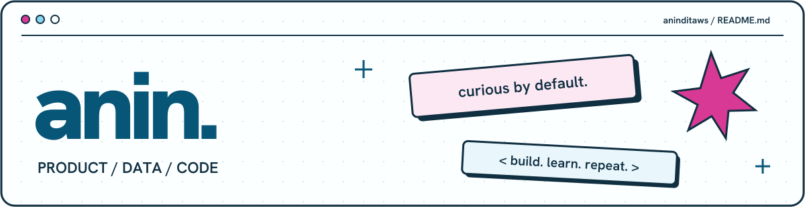

  <strong>Anindita Widya Santoso</strong> · Junior Product Manager at <strong>Xendit</strong> · 
  Information Systems and Technology graduate, <strong>ITB</strong>.

### Selected work

- **[Stock Data ETL](https://github.com/aninditaws/Indonesian-Stock-Data-ETL)** — Collected IDN Financials data, built Python/Pandas transformations, and designed the PostgreSQL schema and ERD.
- **[Phishing URL Classifier](https://github.com/aninditaws/Phishing-URL-Classifier)** — Handled data cleaning, preprocessing, and pipeline assembly; teammates implemented the classifiers.
- **[Magic Cube Solver](https://github.com/aninditaws/Diagonal-Magic-Cube-Solver)** — Implemented the genetic algorithm in a team project comparing search approaches.
- **[Retail BI thesis](https://aninditaws.github.io/projects/retail-bi/)** — Built daily warehouse updates, demand forecasting, five dashboards, and a Telegram stock/reordering bot. Linked case study.

### Toolkit

### Say hi

  
  
  
  

